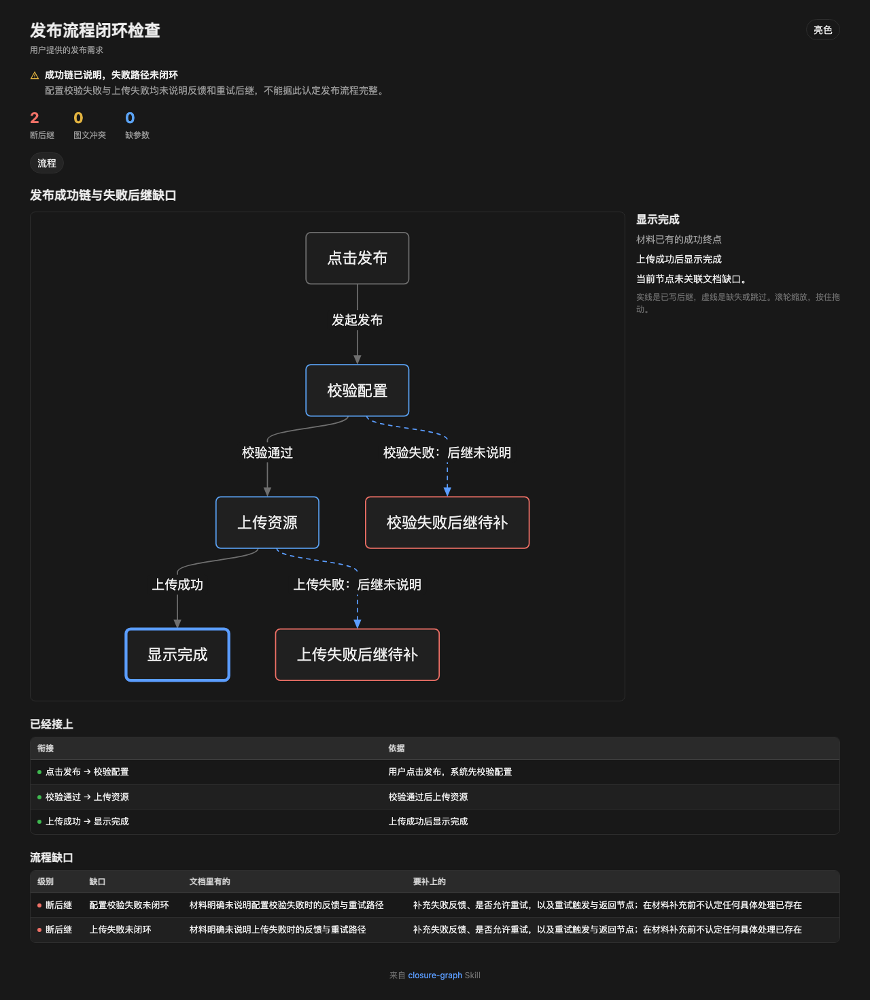

# 修炼笔记

## **时间** : 2026-11-26

**小记** :
- 升级 Mac Mini 上的语音转写，从 mlx-whisper 换成 Qwen3-ASR-0.6B
- 项目放到了 [qwen3-asr-server](https://github.com/gitByEOS/qwen3-asr-server)，有兴趣可以看看
- 以下是拿一段视频做的测试

**性能** :
- 视频时长：111.666 秒；文件大小：5.8 MB
- 分段：23.0、29.8、29.2、27.0 秒
- ffmpeg 预处理：0.574 秒；MLX 4-bit 推理：9.402 秒
- 总耗时：9.982 秒；速度：11.19 倍实时；RTF：0.089
- 第一段含模型冷加载：5.485 秒；后续约 30 秒分段：每段约 1.3 秒
- 输出：671 字，415 次增量更新

**仅有误识别** :
- “赤金子” → “斥巨资”（视频咬字不清）
- “这几根影视” → “自己的影音室”（视频吞字）
- “玩金山花” → “玩健身环”（视频吞字）

## **时间** : 2026-11-25

**小记** :
- [hy-mt-server](https://github.com/gitByEOS/hy-mt-server) 从 Hy-MT2 更新 Hy-MT3，准确更高，支持语种更多
- 补充了如何接入沉浸式翻译
- 新增 [小记可视化](https://gitbyeos.github.io/open-part-skills/#notes)

## **时间** : 2026-11-16

**小记** :
- 新增 [closure-graph](https://gitbyeos.github.io/open-part-skills/skill-matrix/dist/?item=closure-graph)，用于初步检测策划需求文档的漏洞
- 把流程、特效与 UI 的衔接画成可点击的图，定位断点、冲突与缺失参数

## **时间** : 2026-11-12

**小记** :
- `ESNote` 更新到 v0.4.1，这次调整了针对项目级别的使用体验
- 统一了 `⌘W` 体验
- 欢迎页改版，能更好的快速打开之前看的文件
- 修复了一些已知bug

**安装包** : [ESNote-v0.4.1](https://github.com/gitByEOS/open-part-skills/raw/refs/heads/main/tools/esnote/ESNote-v0.4.1.dmg)（仅 macOS）

## **时间** : 2026-11-05

**小记** :
- [task-polling](https://gitbyeos.github.io/open-part-skills/skill-matrix/dist/?item=task-polling) 更新到 v1.1.0，继续围绕 `docs/task.md` 管理任务，这次引入轮次和初始环境概念
- 领取时记录初始 commit，每轮记录 Agent 对任务的理解和改动目录，回头能看清是怎么理解、改了哪些地方
- 验收没通过，原因留在上一轮，返工对照任务行上的目标和未通原因继续进行
- 完成后如果一个任务轮次较多，则能够以`初始环境+轮次描述`为依据，做到`环境还原`迭代`spec`和`rule`，降低轮次

## **时间** : 2026-11-02

**小记** :
- 新增 SKILL [speak-7d](https://gitbyeos.github.io/open-part-skills/skill-matrix/dist/?item=speak-7d)
- 一句没头没尾的反馈丢过去，对方还得再问什么时间、问题细节是什么、找谁、要做什么
- 补齐沟通中足够的信息，减少工作交流中的磨损

## **时间** : 2026-10-29

**小记** :
- 新增 SKILL [memory-card](https://gitbyeos.github.io/open-part-skills/skill-matrix/dist/?item=memory-card)，把课文写成记忆卡 JSON，再导出钉纸网页
- 每段一张卡，标题写成「段落一 · 乌云先至」
- 主界面是钉纸地图；点节点进入叠卡，只看串联和原文，左右滑都到下一张

## **时间** : 2026-10-28

**小记** :
- `ESNote` 更新到 v0.3.2，这次继续打磨长文档的阅读和滚动体验
- 滚动条改为刻度条，只标出 `##` 与 `###` 标题，让定位更精确
- 优化滚动体验，保持编辑与预览模式的滚动体验一致

## **时间** : 2026-10-26

**小记** :
- `ESNote` 更新到 v0.3.1，这次主要打磨预览和编辑之间的跳转体验
- 看预览时双击，可以落到对应的代码行、表格行、引用行或段落行，并按预览选中的文字标出，减少切回源码后重新找位置的麻烦
- 更换了 `Mermaid` 图表渲染插件

## **时间** : 2026-09-23

**小记** :
- 新增 SKILL [mindmap](https://gitbyeos.github.io/open-part-skills/skill-matrix/dist/?item=mindmap)，生成一个 `.md` 文件和一个 `.html` 文件
- 一个利于 agent 阅读，一个利于人阅读，`.html` 完全由脚本生成，可指定到 ignore 目录下
- 顺手优化了下 [skill-matrix](https://gitbyeos.github.io/open-part-skills/#skill-matrix) 细节

### 解决了什么问题
1. AI 总是生成总结性的文字，从而忽略细节和结构性
2. 减少大段落文本，合适的结构，更少的token，带来更大信息量
3. html 支持折叠，想看细节看细节，想看大纲看大纲
4. 探索项目时，文件和代码用树形结构表达更简洁，远优于表格和段落
5. 用拓扑深度硬要求，轻松解决 ai 看懂了，说不明白的问题

## **时间** : 2026-09-18

**小记** :
- `qbot` 支持了语音格式附件接收，完善了开会手机录音发给 `qbot` 然后 Agent 总结成文档回传给我的工作场景，可以避免遗漏重要事项
- `meet-digest` 是配套的从 `.wav` 原文件最后归纳为 `.md` 的 Skill
- `qbot` 针对性修复了长程任务的输出bug，qq 要是单条 msg 5000 chars 的限制去掉就好了

## **时间** : 2026-09-11

**小记** :
- `ESNote` 更新到 v0.3.0，日常使用中做了些优化
- 新增 Finder 空格预览 `.md`，随手一按就能看，不用先开编辑器
- 修复已知 bug：外部变更冲突面板按钮导致崩溃、`⌘R` 退出预览时编辑区跳到顶部

**安装包** : [ESNote-v0.3.0](https://github.com/gitByEOS/open-part-skills/raw/refs/heads/main/tools/esnote/ESNote-v0.3.0.dmg) (1.9M, 仅MacOS)

## **时间** : 2026-09-04

**小记** :
- 新增 Skill `task-polling`，这个一个简单的约束，缺有大大的收益

### 解决了什么问题
有了这套规范后，不管什么想法或者问题直接往 `## 未领取` 写就可以了，更容易进入心流

就不会：
- 做功能时，出现 bug，容易迷失方向
- 注意力被当前跑偏任务分散
- 中途中断了或者跑偏，又要把大段文字重新敲一遍
- 完成的任务，没记录，让三方 Agent 评审没有依据
- 一次性修改大量文件，提交不知道写什么，发版本 CHANGELOG 不知道改了啥
- 确认不做的功能，Agent 反复问

这样多开N个项目推进更方便，面向 Markdown 编程

## **时间** : 2026-08-25

**小记** :
- 新增 `bad-solution`，当对 Agent 给出的方案不满意时，强制触发反思机制，适用于代码开发

## **时间** : 2026-08-18

**小记** : 
- 花了四五天开发了 `ESNote` 一个 Mac 高性能 Markdown 编辑器，风格模仿 `Sumblime` 走极简，还支持 CLI  导出图片、HTML、PDF 等，为 Skill 做支持；
- 通知还内嵌了term，支持 `⌘+鼠标` 点开直接跳转文件，方便使用 tui 使用；
- 做这个一是为了测试 grok 能力，二是从零开始再整合一下 Skills，三是自己实际需求，VSCode越来越卡了， Sublime 插件也不满意，而且现在看Markdown的时间可能占80%；
- 不得不感叹，在不需要外部资源依赖的情况下，模仿这块儿 AI 真是太强了。
- 自此我的专武也从三件拓展为四件：专属代理`mock-ollama`、专属TUI`clash`、专属机器人`qbot`、专属Md+Term `esnote`
- 以后想要什么东西全都可以自己加，不过现在还是依赖 `claudecli v2.1.187`，等 `dsh` 完善了可以考虑对接一下

**安装包** : [ESNote-v0.2.3](https://github.com/gitByEOS/open-part-skills/raw/refs/heads/main/tools/esnote/ESNote-v0.2.3.dmg) (1.7M, 仅MacOS)